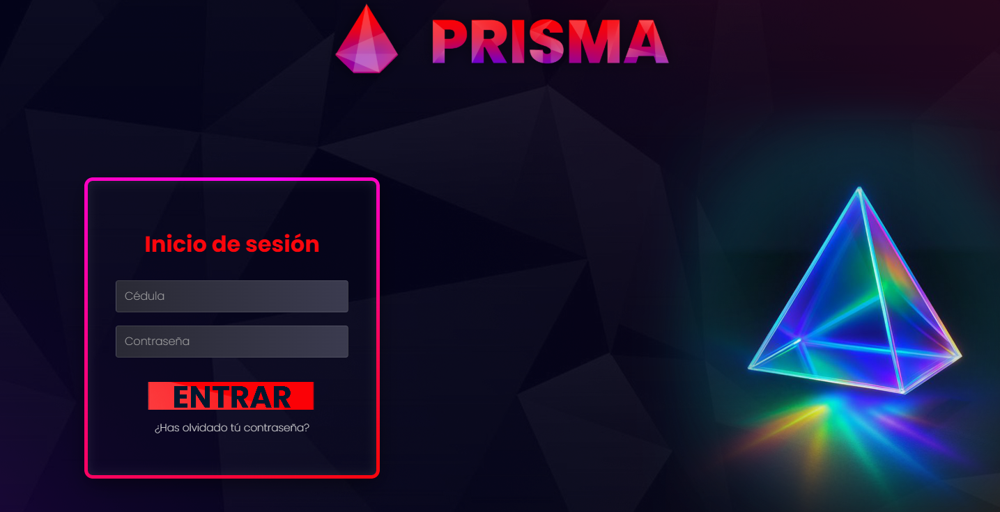
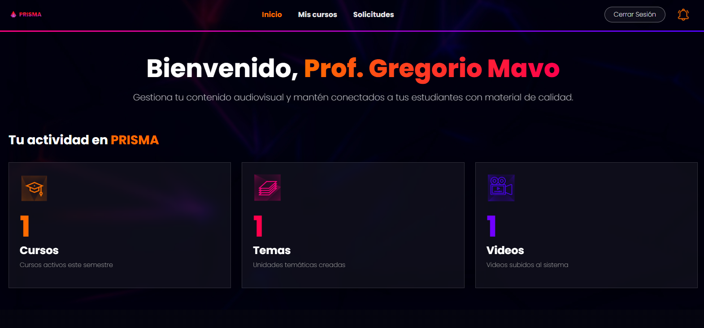
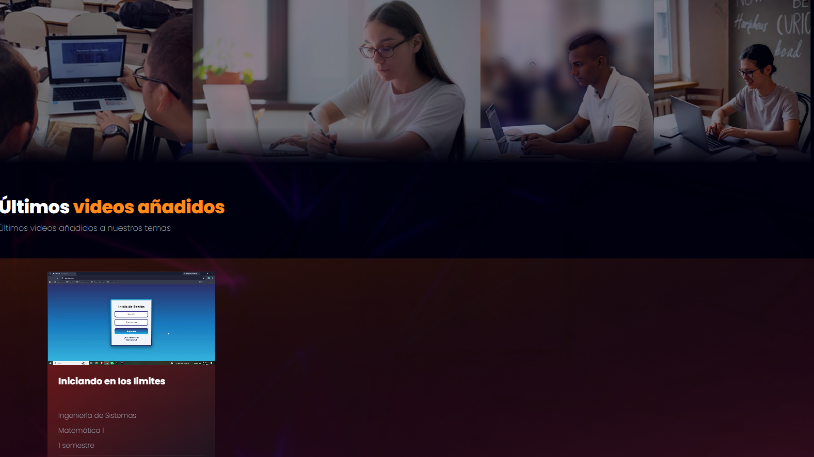
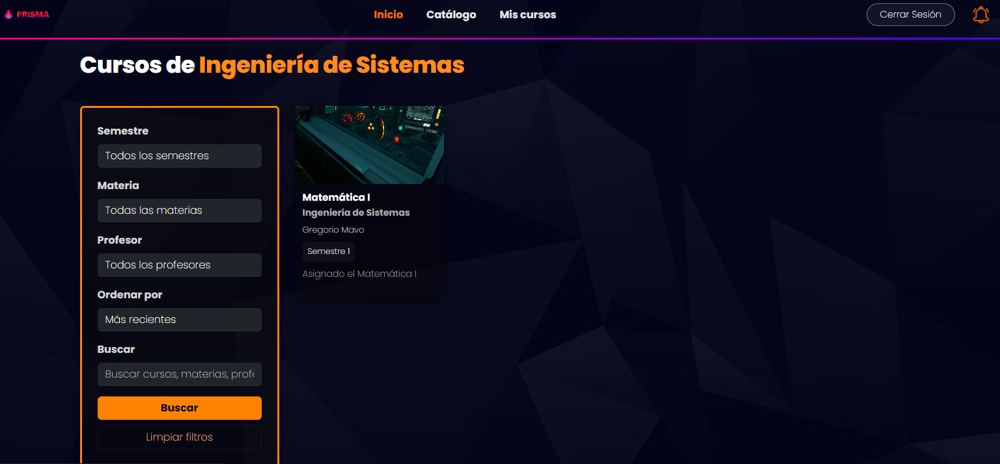
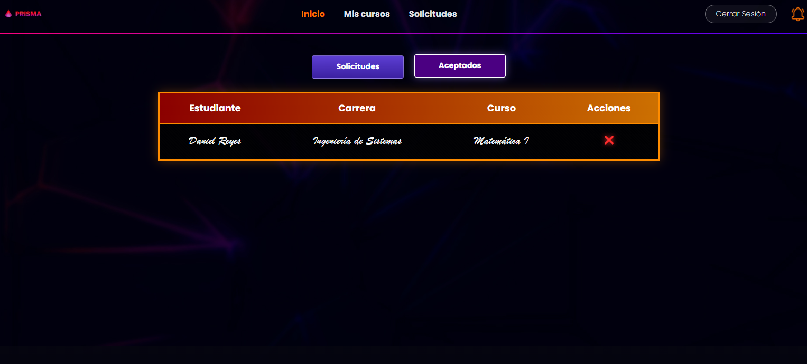
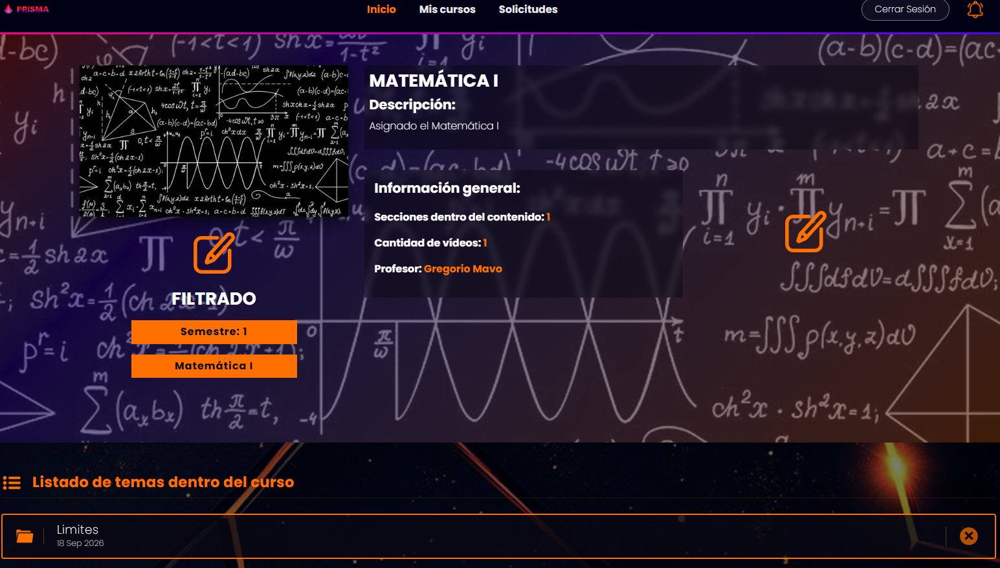
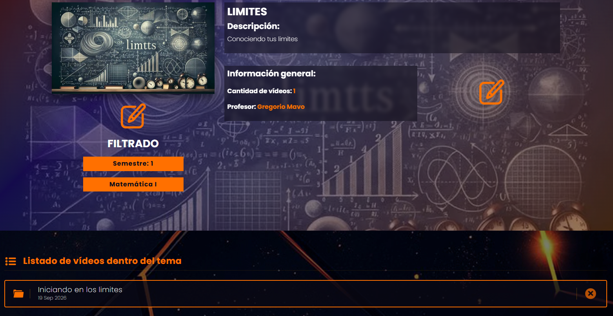

<div align="center">

[](https://git.io/typing-svg)

### *“Los distintos espectros del saber proyectados a través del conocimiento”* 

Plataforma virtual universitaria diseñada para la gestión integral de clases, cursos y contenidos académicos, inspirada en la forma en que la luz se refracta a través de un prisma.


</div>

---

## 🧭 Navegación

- [🧭 Navegación](#-navegación)
- [✨ Descripción General y Roles](#-descripción-general-y-roles)
- [🛠️ Stack Tecnológico](#️-stack-tecnológico)
  - [Backend y Base de Datos](#backend-y-base-de-datos)
  - [Frontend y Estilos](#frontend-y-estilos)
- [📸 Capturas de Pantalla](#-capturas-de-pantalla)
  - [1. Inicio de Sesión](#1-inicio-de-sesión)
  - [2. Panel del Profesor](#2-panel-del-profesor)
  - [3. Sección de Clases y Últimos Videos](#3-sección-de-clases-y-últimos-videos)
  - [4. Catálogo de Cursos y Filtros](#4-catálogo-de-cursos-y-filtros)
  - [5. Gestión de Solicitudes](#5-gestión-de-solicitudes)
  - [6. Detalle del Curso y Listado de Temas](#6-detalle-del-curso-y-listado-de-temas)
  - [7. Contenido del Tema y Videos](#7-contenido-del-tema-y-videos)
- [🚀 Instalación y Puesta en Marcha](#-instalación-y-puesta-en-marcha)
  - [Requisitos Previos](#requisitos-previos)
- [📄 Licencia](#-licencia)

---

## ✨ Descripción General y Roles

**Prisma** simula el flujo de trabajo de una institución universitaria, estructurando el acceso y la interacción mediante tres tipos de usuarios principales:

*   🛠️ **Administrador:** Gestión total del sistema, control de usuarios y supervisión general de la plataforma.
*   👨‍🏫 **Profesores:** Creación y gestión de sus cursos, subida de temas, publicación de material audiovisual (videos), gestión de estudiantes inscritos y revisión de solicitudes de inscripción.
*   🎓 **Estudiantes:** Envío de solicitudes de inscripción a los cursos disponibles, visualización de temas y reproducción de clases en video dentro de un entorno intuitivo.

---

## 🛠️ Stack Tecnológico

### Backend y Base de Datos
*   **Lenguaje:** Python 3.11+
*   **Framework:** Django 5.1.x (ORM, panel de administración y sistema de plantillas).
*   **Base de Datos:** SQLite.

### Frontend y Estilos
*   **Estructura y Diseño:** Django Template Language junto al framework Bootstrap 5.3.
*   **Interactividad:** JavaScript.

---

## 📸 Capturas de Pantalla

### 1. Inicio de Sesión
Interfaz de autenticación con diseño estilizado y validación por cédula y contraseña.


### 2. Panel del Profesor
Vista general de bienvenida para el docente, mostrando métricas de cursos activos, temas y videos subidos.


### 3. Sección de Clases y Últimos Videos
Visualización dinámica del contenido audiovisual reciente disponible en la plataforma.


### 4. Catálogo de Cursos y Filtros
Buscador avanzado y filtros por semestre, materia, profesor u orden de preferencia.


### 5. Gestión de Solicitudes
Panel donde los profesores pueden aprobar o rechazar las solicitudes de inscripción de los estudiantes.


### 6. Detalle del Curso y Listado de Temas
Administración interna de un curso (ej. Matemática I), con desglose de información general y unidades temáticas.


### 7. Contenido del Tema y Videos
Gestión de unidades específicas y los videos instructivos asociados dentro del tema.


---

## 🚀 Instalación y Puesta en Marcha

El proyecto se ejecuta de forma local conectándose a una base de datos SQLite.

### Requisitos Previos
*   **Intérprete de Python 3.11+.** Se verifica con el comando:
    ```bash
    python --version
    ```
*   **SQLite** configurado y en ejecución.
*   **Git** instalado.

## 📄 Licencia

Todos los derechos reservados.